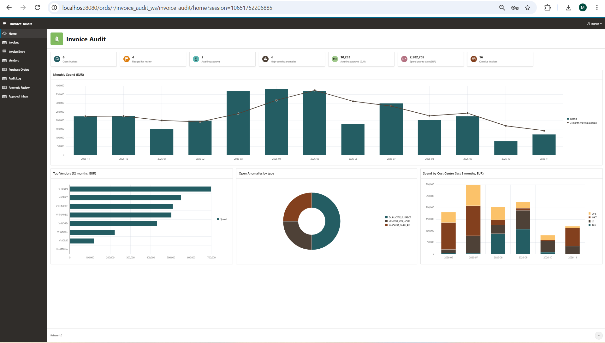
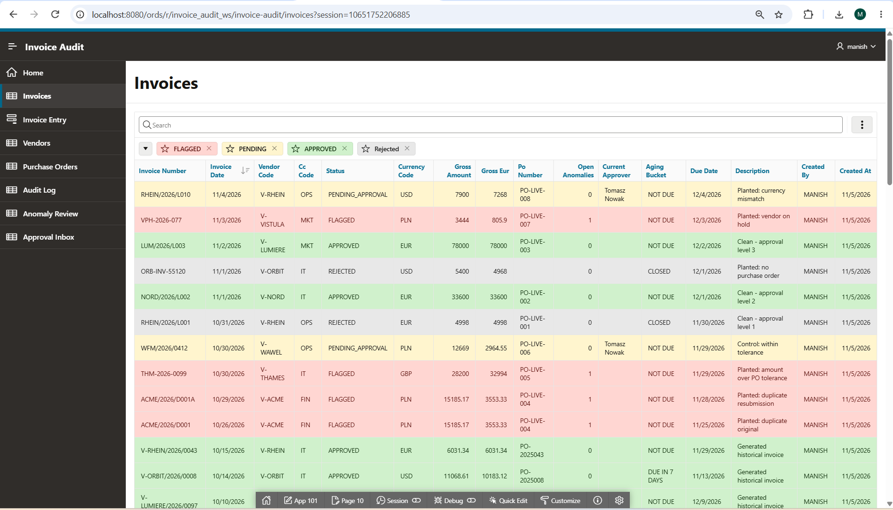
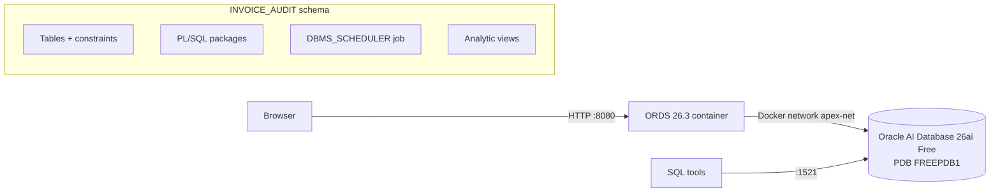
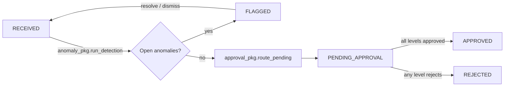
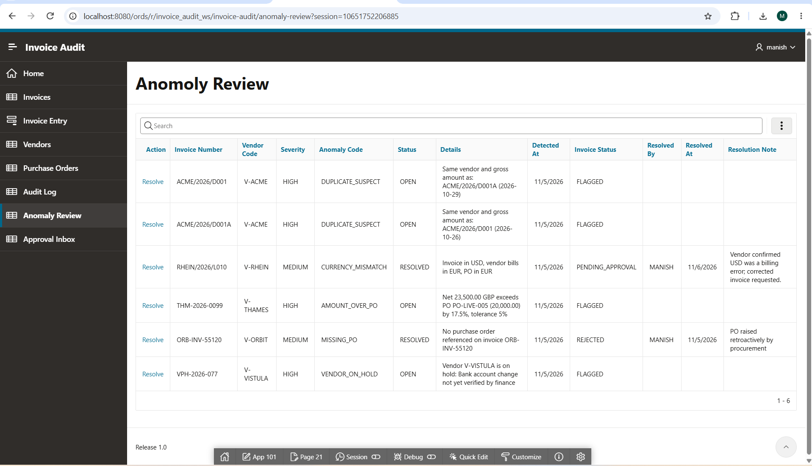
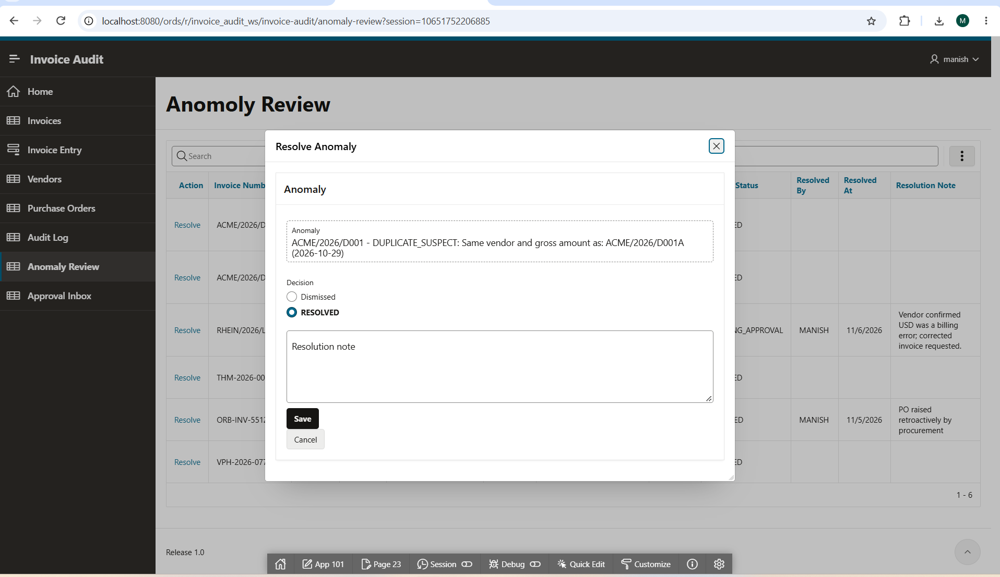
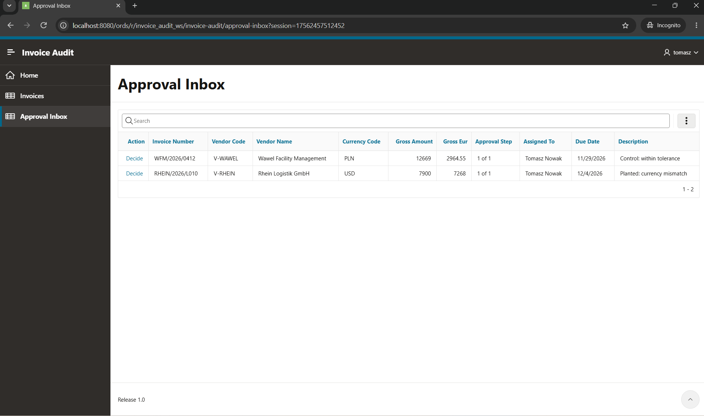
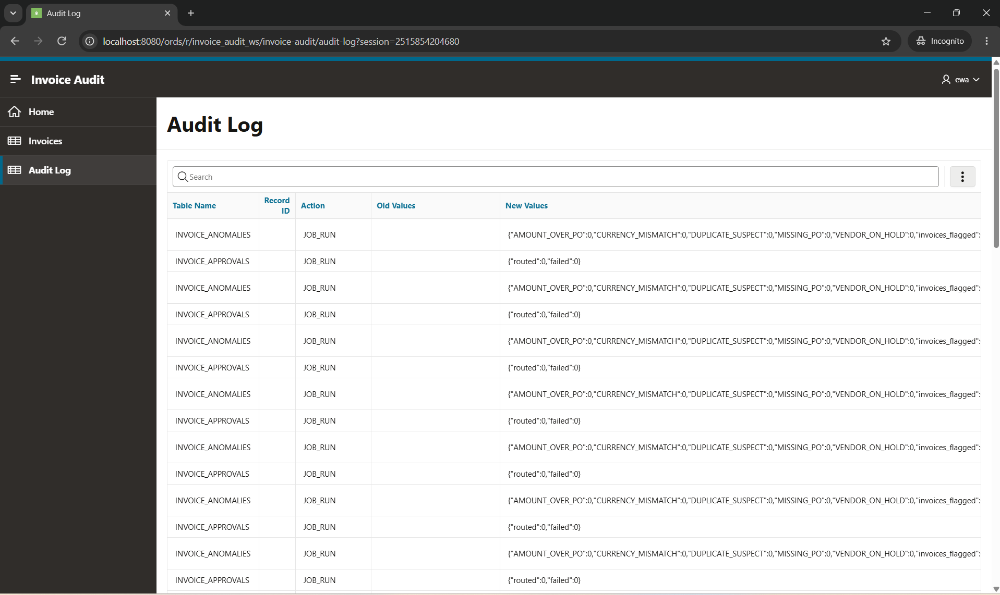

# Supplier Invoice Audit & Approval System

An end-to-end **Oracle Database + Oracle APEX** application for accounts payable: invoices are logged,
automatically checked for anomalies, routed through multi-level approval by amount, and fully audited.
Built from scratch on a local Docker stack.



---

## Tech stack

| Layer | Technology |
|---|---|
| Database | Oracle AI Database 26ai Free (23ai, release 23.26.3), running in Docker |
| Web tier | Oracle REST Data Services (ORDS) 26.3, separate Docker container |
| UI | Oracle APEX 26.2 |
| Languages | SQL, PL/SQL |
| Host | Windows 11, Docker Desktop (WSL2 backend) |

---

## What it does

- **Invoice intake**: entry form with cascading lists (a vendor's open POs only), database-enforced defaults and validation
- **Automated anomaly detection** (scheduler job every 15 minutes):
  - suspected duplicates (same vendor and amount within a configurable window)
  - invoice amount above PO beyond a configurable tolerance (default 5%)
  - vendor on hold, missing purchase order, currency mismatch
- **Statistical outlier detection**: z-score of each invoice against the vendor's history, which catches unusual amounts that no fixed rule flags
- **Anomaly review**: resolve or dismiss with a mandatory note; the invoice returns to the queue when its last anomaly is closed
- **Multi-level approval** by amount converted to EUR (up to EUR 10k / 10k-50k / above 50k), with:
  - only the assigned approver can decide on the current level
  - segregation of duties (no approving invoices you entered)
  - comment required on rejection, final approver's limit must cover the amount
  - row locking (`FOR UPDATE NOWAIT`) against concurrent decisions
- **Complete audit trail** of every status change, decision and error, stored as JSON
- **Dashboard**: KPI cards, monthly spend with 3-month moving average, top vendors, anomalies by type, spend by cost centre
- **Role-based access**: clerk, approver, finance manager, CFO, auditor and admin see different menus and pages



---

## Architecture



**Processing pipeline** (scheduler job, every 15 minutes):



**Business logic lives in the database.** The APEX pages only call the PL/SQL packages, so every rule
(validations, routing, segregation of duties, logging) also applies to any other client or script.

---

## Oracle features demonstrated

**Schema design**
- Identity columns, virtual column (`gross_amount = net + tax`), single- and multi-column CHECK constraints
- Foreign keys **with indexes** (Oracle doesn't index FKs automatically)
- `DEFAULT ON NULL`, so APEX forms (which send explicit NULLs) still get defaults
- Native `JSON` data type, `CREATE ... IF NOT EXISTS`, `DB_DEVELOPER_ROLE` (23ai)

**PL/SQL** (`audit_pkg`, `anomaly_pkg`, `approval_pkg`)
- Packages with overloaded functions, local subprograms, `BULK COLLECT`, `RETURNING INTO`
- **Autonomous transactions** for event and error logging, with `DBMS_UTILITY.FORMAT_ERROR_BACKTRACE`
- **Dynamic SQL** (`EXECUTE IMMEDIATE` with bind variables): each anomaly rule is a query stored in a table, so a new check is a new row, not a code change
- Per-rule exception isolation, `SAVEPOINT` / `ROLLBACK TO` per invoice in batch routing
- `FOR UPDATE NOWAIT` locking, `RAISE_APPLICATION_ERROR` with business error codes
- Row-level triggers building before/after snapshots with `JSON_OBJECT_T`

**Scheduling**
- `DBMS_SCHEDULER` job running detection and routing as a pipeline; idempotent, so re-runs never duplicate results

**SQL analytics** (`06_reporting.sql`)
- `LAG`, moving averages and running totals with window frames, year-to-date via `PARTITION BY`
- `RANK`, `NTILE`, `RATIO_TO_REPORT`, cumulative share (Pareto), `KEEP (DENSE_RANK LAST)`
- Analytic functions over aggregates (`SUM(SUM(x)) OVER (...)`)
- `AVG` / `STDDEV OVER (PARTITION BY ...)` for z-scores, `PERCENT_RANK`
- `UNPIVOT` for the KPI cards

**APEX**
- Interactive reports with saved default layouts and row highlighting
- Charts (combination, horizontal bar, donut, stacked bar), cards region
- Modal dialogs calling PL/SQL, dynamic actions, cascading LOVs
- Authorization schemes driven by the application's own `APP_USERS` table

---

## Design decisions

**1. Two kinds of audit records, two transaction behaviours.**
Data changes are logged **in the same transaction** (`audit_pkg.log_change`): if the change rolls back,
its log entry rolls back too, so the log never claims something happened that didn't.
Events and errors are logged in an **autonomous transaction** (`log_event`, `log_error`): they survive a
rollback, which is exactly when you need them. Gaps in the audit log's identity values are physical
evidence of rolled-back changes.

**2. Rules as data.**
Anomaly checks are SQL queries stored in `ANOMALY_TYPES.DETECTION_SQL` and executed with dynamic SQL.
Thresholds (tolerance %, duplicate window) live in `APP_SETTINGS`, so finance can tune them without a
deployment. Because stored SQL is an injection surface, rule queries are owner-maintained configuration,
never built from user input, and runtime values are passed as bind variables.

**3. Rules and statistics catch different things.**
The €78,000 invoice `LUM/2026/L003` passes every rule (valid PO, active vendor, correct currency), but
its z-score of about 3 against the vendor's history puts it on the outliers report.

**4. Corrections never rewrite history.**
When an approver clicked *Approve* instead of *Reject*, the fix was an audited correction: the original
decision stays in the log, followed by a `CORRECTION` entry with the reason and requester.

**5. Who executed vs who decided.**
The audit log records the session user (`changed_by`) separately from the business actor in the JSON
(`"by": "TOMASZ"`), which makes actions taken on someone's behalf visible.

---

## Screens

| | |
|---|---|
|  |  |
| Anomaly review | Resolve dialog (calls `anomaly_pkg`) |
|  |  |
| Approval inbox (logged in as an approver) | Audit trail (logged in as the auditor) |
|  |  |
| Statistical outliers | Local Docker stack |

---

## Repository structure

```
db/
  00_create_schema.sql   schema owner + grants (run as SYS)
  01_tables.sql          tables, constraints, indexes
  02_seed_data.sql       reference data, 240 generated historical invoices, 10 planted test scenarios
  03_audit.sql           audit_pkg + triggers
  04_anomaly.sql         rule-driven detection (dynamic SQL) + scheduler job
  05_approval.sql        approval routing and decisions; extends the job into a pipeline
  06_reporting.sql       analytic views for dashboard and reports
  07_form_defaults.sql   DEFAULT ON NULL for form compatibility
apex/
  f101.sql               APEX application export
docs/screenshots/
```

---

## Running it locally

**Prerequisites:** Docker Desktop, about 25 GB free disk, 8 GB RAM for Docker.

**1. Database**
```powershell
docker network create apex-net
docker volume create oracle-free-data
docker run -d --name oracle-free --network apex-net -p 1521:1521 `
  -e ORACLE_PWD=<password> -v oracle-free-data:/opt/oracle/oradata `
  container-registry.oracle.com/database/free:latest
```
Wait until `docker logs oracle-free` shows `DATABASE IS READY TO USE!`.

**2. ORDS + APEX**: download and unzip `apex-latest.zip` from oracle.com, then:
```powershell
docker volume create ords-config
docker run -d --name ords --network apex-net -p 8080:8080 `
  -e CONN_STRING=oracle-free:1521/FREEPDB1 -e ORACLE_PWD=<password> -e ORACLE_USER_PWD=<password> `
  -v ords-config:/etc/ords/config -v <path-to-unzipped>\apex:/opt/oracle/apex `
  container-registry.oracle.com/database/ords:latest
```
The first start installs ORDS and APEX into FREEPDB1 (10 to 25 minutes). APEX is then at
`http://localhost:8080/ords/apex`.

**3. Schema and workspace**
- Run `db/00_create_schema.sql` as SYS in FREEPDB1.
- In APEX administration (workspace `INTERNAL`), create a workspace using the existing schema `INVOICE_AUDIT`.

**4. Database objects**: run `db/01` to `db/07` **in order** as `INVOICE_AUDIT`
(for example in SQL Workshop → SQL Scripts). Scripts 02 to 07 are re-runnable.

**5. Application**: App Builder → Import → `apex/f101.sql`.

**6. Users**: create APEX accounts matching `APP_USERS` (`MANISH`, `ANNA`, `TOMASZ`, `KATARZYNA`, `PIOTR`, `EWA`).
Roles are read from the `APP_USERS` table.

**Daily start/stop**
```powershell
docker start oracle-free   # wait for (healthy) in docker ps
docker start ords
docker stop ords
docker stop oracle-free
```

---

## Possible next steps

- "Reverse decision" feature for finance managers instead of scripted corrections
- Email notifications to approvers via `APEX_MAIL`
- REST endpoints (ORDS) for invoice intake from other systems
- utPLSQL unit tests for the packages
- Deployment pipeline with SQLcl / Liquibase

---

**Author:** kmanishgoud